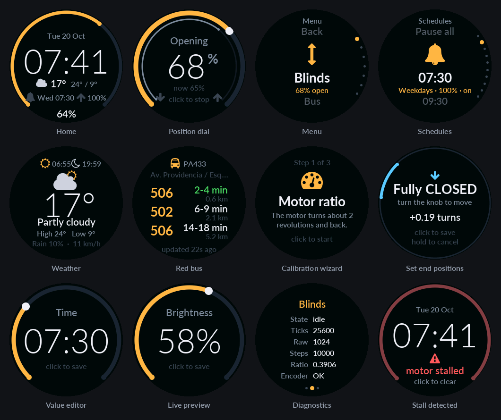
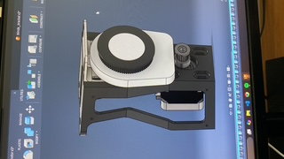

# automated-curtains

Motorized roller blinds controlled by an ESP32: a NEMA 17 stepper with a
TMC2209 driver, an AS5600 magnetic encoder for absolute position, and a
smart-knob style controller (rotary encoder and GC9A01 round display). It also
has a web app and API, so an iPhone Shortcut can open the blinds when the alarm
goes off.

- Project idea and goals: [idea.md](idea.md)
- Firmware, wiring, setup, API and testing: [firmware/README.md](firmware/README.md)

