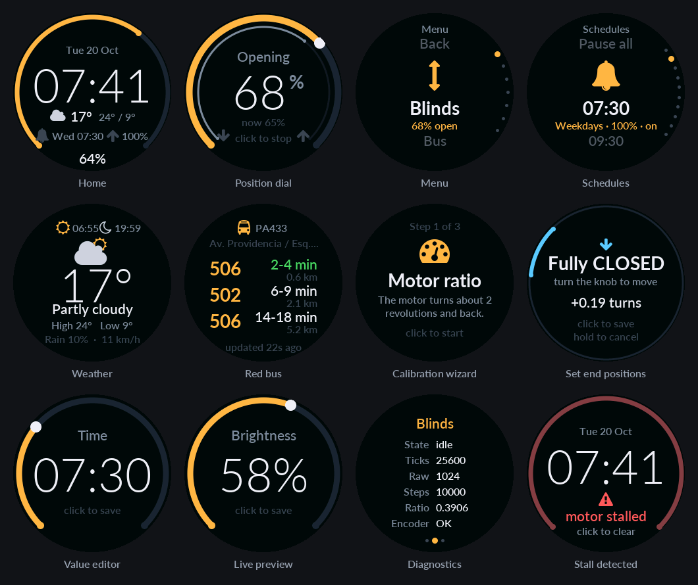

# Smart Blinds — firmware

ESP32 firmware for a motorized roller blind with a smart-knob style controller:
a NEMA 17 + TMC2209 drive, an AS5600 magnetic encoder for absolute position,
an EC11 rotary knob and a GC9A01 round display, plus a web app/REST API for
phone shortcuts and automations.



*(All screenshots are the real firmware, rendered by the ESP32 and captured
over serial with `tools/screenshot.py`.)*

## Features

- **Closed-loop positioning**: the AS5600 is the source of truth (multi-turn
  tracking). Moves are verified and corrected against the encoder, and
  **stalls are detected** (blind blocked, motor slipping, wrong direction).
- **Silent and smooth**: hardware step generation (FastAccelStepper) for
  StealthChop-friendly step timing. Optional TMC2209 UART link sets current,
  microsteps and silent mode from the menu.
- **Position survives reboots**: saved to flash after every move (and every
  5 s during long moves), then re-attached to the encoder angle at boot.
- **Knob UI** on the round display: clock, date, weather and next alarm when
  idle. Turn to dial a position, click for the menu, hold to open/close.
  Animated menus, value editors, calibration wizard, diagnostics. Dims and
  turns off when idle, wakes up when the blind moves.
- **Gentle moves**: open slowly over N minutes, e.g. a sunrise-style wake-up.
- **Schedules** (8): fixed time, **sunrise or sunset ± offset** (computed
  locally from your coordinates), per weekday, any position, gentle or not.
  "Pause all" for holidays.
- **Web app** at `http://blinds.local`: control, schedules, calibration,
  settings, logs, driver status, firmware upload. Simple GET endpoints for
  **iPhone Shortcuts** (your alarm automation) and Home Assistant.
- **Weather** (Open-Meteo, no API key) and **Red bus arrivals** for your stop.
- **WiFi setup portal** (no hard-coded credentials), **OTA updates**, serial
  console, and serial **screenshots**.
- **A test firmware for every module**, a full **simulator mode** (no motor or
  encoder needed) and on-device **unit tests**.

## Hardware

| Part | Notes |
|---|---|
| ESP32 DevKit (WROOM, 4 MB) | `board = fm-devkit` in `platformio.ini`; any ESP32 devkit works |
| NEMA 17 stepper + TMC2209 module | STEP/DIR/EN; UART optional |
| AS5600 magnetic encoder + diametric magnet | on the motor shaft or the roller, any ratio works |
| GC9A01 1.28" 240×240 round IPS (SPI) | with backlight pin |
| EC11 rotary encoder with push button | |
| 12–24 V supply for the motor, 5 V → ESP32 | 100 µF capacitor across the TMC2209 VM/GND |

### Wiring

All pins are defined in [`include/config.h`](include/config.h).

| Function | ESP32 GPIO | Connect to |
|---|---|---|
| I2C SDA / SCL | 21 / 22 | AS5600 SDA / SCL (module 3.3 V, **DIR pin to GND**) |
| Knob A / B / switch | 32 / 33 / 13 | EC11 A, B, SW (other legs to GND; internal pull-ups) |
| Motor STEP / DIR / EN | 27 / 14 / 12 | TMC2209 STEP, DIR, EN |
| TMC2209 UART RX / TX (optional) | 16 / 17 | RX → PDN_UART; TX → **1 kΩ** → PDN_UART |
| Display SCLK / MOSI | 18 / 23 | GC9A01 SCL / SDA |
| Display CS / DC / RST / BL | 5 / 19 / 4 / 25 | GC9A01 CS, DC, RST, BL |

> ⚠ **GPIO12 (motor EN) is a boot strapping pin.** If your TMC2209 board pulls
> EN high, the ESP32 won't boot (flash voltage gets set to 1.8 V). If that happens,
> move EN to GPIO26 and change `PIN_MOTOR_EN`.
>
> In standalone mode (no UART), the TMC2209's MS1/MS2 pins set microstepping
> (both low = 1/8) and its potentiometer sets the current. With UART connected,
> both come from the menu/web settings instead.

## Build & flash

Install [PlatformIO](https://platformio.org/) (the VS Code extension or `pip install platformio`).

```bash
cd firmware
pio run -e blinds -t upload -t monitor     # build, flash over USB, open the serial monitor
```

Later updates can go over WiFi:

```bash
pio run -e blinds-ota -t upload            # OTA to blinds.local (password: "blinds")
```

or upload `.pio/build/blinds/firmware.bin` from the web app (**System → Firmware update**).

## First-time setup

1. **WiFi**: on first boot the display shows *WiFi setup*. Join the network
   **Blinds-Setup** with your phone, pick your WiFi and enter the password. The
   device reboots and is then reachable at **http://blinds.local**. If the saved
   network is unreachable for 3 minutes after boot, the portal reopens for 5
   minutes, then it goes back to retrying. You can also open it any time from
   *Settings → WiFi*.
2. **Calibrate** (knob: *Menu → Calibrate → Setup wizard*, or the web app's
   *Calibrate* tab):
   1. *Motor ratio*: with the blind half open, the motor turns ~2 revolutions
      and back. This learns steps per encoder tick and the encoder direction.
   2. *Closed position*: turn the knob until the blind is fully closed, then click.
   3. *Open position*: same for fully open.

   If turning the knob moves the blind the "wrong" way, enable
   *Calibrate → Reverse motor* (your saved positions stay valid).
3. **Location and bus stop** (web *Settings*): latitude/longitude (for
   weather and sunrise/sunset), time zone (default: Chile), and your Red stop
   code (the code printed on the stop sign, e.g. `PA433`). Optionally limit it
   to some services (`506, 507`).
4. **Schedules** (web *Schedules* tab, or *Menu → Schedules* on the knob).

## Using the knob

| Where | Turn | Click | Hold (0.7 s) |
|---|---|---|---|
| Home (clock) | open the position dial; the blind follows | main menu (or clear an error) | toggle open/close, or stop if moving |
| Position dial | change target (spin fast for bigger steps) | stop / go now | back |
| Menus | scroll | select | back |
| Value editors | change | save | cancel |

The screen dims after 20 s and turns off after 2 min (configurable). The first
input on a dark screen only wakes it up. The screen also wakes whenever the
blind moves.

## Web app & REST API

Open **http://blinds.local** (or the IP shown in *Menu → Settings → System → Info*).

| Endpoint | Description |
|---|---|
| `GET /api/status` | position, state, errors, WiFi, time, next schedule, weather (JSON) |
| `GET/POST /api/open`, `/api/close` | add `?gentle=1` (gentle duration from settings) or `?duration=<s>` |
| `GET/POST /api/position?value=<0-100>` | go to a position, `&duration=` optional |
| `GET/POST /api/stop`, `/api/toggle` | stop / toggle (stop if moving) |
| `GET/POST /api/jog?ticks=<n>` | relative move ignoring limits (4096 ticks = 1 encoder turn) |
| `GET/POST /api/calibrate?action=open\|closed\|ratio\|reset` | calibration |
| `GET/POST /api/clear` | clear a stall/error |
| `GET/POST /api/settings` | read / partially update settings (JSON body) |
| `GET/POST /api/schedules` | read / replace the 8 schedules (JSON array) |
| `GET /api/bus` | bus arrivals for the configured stop |
| `GET /api/log`, `GET /api/driver` | recent log lines / TMC2209 report |
| `GET/POST /api/system?action=reboot\|forget-wifi\|factory-reset\|pause-schedules\|resume-schedules` | system |
| `POST /update` | firmware upload (multipart) |

The old URLs `/open`, `/close`, `/stop` and `/toggle` still work, so existing shortcuts keep working.

**Security**: on a trusted home network no auth is needed. If you set an *API
token* in Settings, control endpoints require `?token=…` (or an `X-Token` /
`Authorization: Bearer` header). The web app asks for it once in *System*.

### iPhone: open the blinds when your alarm goes off

1. *Shortcuts* app → **Automation** → **+** → **Alarm** → *Is Stopped* (or
   *Goes Off*) → choose your wake-up alarm → **Run Immediately**.
2. Add the action **Get Contents of URL** with
   `http://blinds.local/api/open?gentle=1` (or `/api/open` for full speed).
3. Optional: a second automation at bedtime with `/api/close`.

Use the IP address instead of `blinds.local` if your phone doesn't resolve
`.local` names. Append `&token=…` if you set an API token.

### Home Assistant (optional)

A minimal REST-based cover (adapt to your Home Assistant version):

```yaml
rest_command:
  blinds_open:  { url: "http://blinds.local/api/open" }
  blinds_close: { url: "http://blinds.local/api/close" }
  blinds_stop:  { url: "http://blinds.local/api/stop" }
  blinds_position: { url: "http://blinds.local/api/position?value={{ position }}" }

sensor:
  - platform: rest
    name: blinds_position
    resource: http://blinds.local/api/status
    value_template: "{{ value_json.position | round(0) }}"
    scan_interval: 10

cover:
  - platform: template
    covers:
      bedroom_blinds:
        device_class: blind
        position_template: "{{ states('sensor.blinds_position') | int(0) }}"
        open_cover:  { action: rest_command.blinds_open }
        close_cover: { action: rest_command.blinds_close }
        stop_cover:  { action: rest_command.blinds_stop }
        set_cover_position:
          action: rest_command.blinds_position
          data: { position: "{{ position }}" }
```

## Testing each module

Each module has its own small firmware, so you can bring the hardware up one
piece at a time. Build, flash and open the monitor with:

```bash
./scripts/test.sh <test> [serial-port]
./scripts/test.sh build-all            # compile everything (no board needed)
```

| Test | Needs | What to check |
|---|---|---|
| `knob` | knob | one +1/−1 per detent (raw count per detent → `KNOB_TRANSITIONS_PER_DETENT`), CLICK and LONG PRESS |
| `encoder` | AS5600 | I2C scan finds `0x36`, "magnet OK", one shaft turn ≈ 4096, count keeps going past 4095 |
| `motor` | driver + motor | `m 1600` turns the motor; `w` wiggles; `i` shows the TMC2209 report if UART is wired |
| `closed_loop` | driver + motor + AS5600 | serial console: `jog 4096`, `ratio`, `setclosed`/`setopen`, `goto 50`; hold the blind to see a stall error |
| `display` | display | colors (fix `invert`/`rgb_order` if wrong), fonts, icons, FPS, backlight fade |
| `ui` | display + knob | full menus against a **simulated** blind with fake clock/weather/bus |
| `web` | ESP32 only | WiFi portal, web app and API against a **simulated** blind |
| `net` | ESP32 only | NTP time, sunrise/sunset, weather and bus data printed to serial |
| `sim` | ESP32 (+ display/knob) | the complete main firmware with a simulated motor and encoder |

The simulator stores its settings in a separate namespace, so it never
touches your real calibration. The `closed_loop` test does use the real one:
anything you calibrate there carries over to the main firmware.

**Unit tests** (sun times, schedules, settings JSON, multi-turn encoder math) run on the board:

```bash
pio test -e unit
```

## Debugging tools

**Serial console** (115200 baud, in the main firmware and the `closed_loop`/`ui`/`web` tests). Type `help`:

```
status | open [s] | close [s] | goto <pct> [s] | stop | toggle | clear
jog <ticks> | setopen | setclosed | ratio | resetcal
settings | set {"maxSpeed":2500} | schedules | wifi | portal | forget
weather | bus | driver | log | heap | reboot | factory
screenshot | knob <n> | click | long          (UI remote control)
```

**Screenshots** of the round display, saved as PNG (close the serial monitor
first; needs pyserial, which PlatformIO's own Python already has):

```bash
~/.platformio/penv/bin/python tools/screenshot.py                  # -> screenshot.png
~/.platformio/penv/bin/python tools/screenshot.py --keys "click,knob 3" -o schedules.png
```

**Logs** without a cable: web app → *System → Log* (or `GET /api/log`).

## How it works

```
 core 1  motion task (2 ms)   AS5600 → multi-turn ticks → closed loop → FastAccelStepper (HW steps)
 core 1  loop task            knob → screens/menus → canvas → GC9A01 (2 strips × 240×120)
 core 0  net task             WiFi/portal, web server + API, ArduinoOTA, scheduler (1 s)
 core 0  fetch task           Open-Meteo (15 min) and Red bus (30 s while viewed)
```

- **Position** is always the encoder's multi-turn tick count. A move converts
  the tick error into steps using the measured ratio, then re-checks the
  encoder after it settles and corrects up to 3 times.
- **Stall detection**: (1) over short windows, the encoder must move at least
  30% of what the steps predict, in the right direction; (2) once the ratio
  is measured, the total following error must stay under *stall tolerance*.
- **Restoring position after power-off**: the AS5600 only knows the angle
  within one turn. At boot the saved multi-turn position is matched to the
  current angle, which works as long as the shaft moved less than half a turn
  while powered off.
- **Display**: a full 240×240 RGB565 frame (115 KB) doesn't fit in one block
  of ESP32 RAM, so each frame is drawn twice into a 240×120 sprite (the canvas
  shifts the y coordinates). Fonts are anti-aliased VLW generated from Lato and
  Font Awesome by `tools/gen_fonts.py`.

## Project structure

```
firmware/
├── platformio.ini          envs: blinds, blinds-ota, test (TEST=<name>), unit
├── include/config.h        pins and hardware constants
├── src/app/main.cpp        main firmware (wires the modules together)
├── src/tests/              one test firmware per module (see above)
├── test/test_logic/        unit tests (pio test -e unit)
├── lib/
│   ├── blinds/             closed-loop motion controller (state machine, stall, calibration)
│   ├── motor/              FastAccelStepper + TMC2209 UART driver, simulated motor
│   ├── magnetic_encoder/   AS5600 multi-turn tracking, simulated encoder
│   ├── rotary_encoder/     knob decoding (ISR) + button click/long-press
│   ├── settings/           persistent settings (NVS, JSON)
│   ├── connectivity/       WiFi + setup portal, NTP, mDNS, ArduinoOTA
│   ├── web/                HTTP server, REST API, embedded web app (web_page.h)
│   ├── services/           weather, Red bus, sunrise/sunset, scheduler
│   ├── display/            GC9A01 config, strip canvas, fonts, icons
│   ├── ui/                 screens, menus, value editors, theme
│   ├── console/            serial command console
│   └── app_log/            logger with an in-RAM ring buffer
├── scripts/                test.sh, select_test.py
└── tools/                  gen_fonts.py, screenshot.py
```

## Customizing

- **Pins**: `include/config.h`.
- **Colors**: `lib/ui/ui_theme.h`.
- **Fonts/icons**: edit `tools/gen_fonts.py` (any TTF, sizes, glyph sets,
  Font Awesome 4.7 code points), run it, and add new icons to `lib/display/icons.h`.
- **Menus**: `lib/ui/menus.cpp`. Each item is one line (`item`, `sub`, `toggle`, `edit`, `confirm`).

## Troubleshooting

| Symptom | Fix |
|---|---|
| ESP32 doesn't boot with the driver connected | GPIO12 strapping: move EN to GPIO26 |
| `AS5600 not found` | check SDA/SCL and 3.3 V; tie the AS5600 **DIR** pin to GND; run the `encoder` test |
| "magnet too weak/strong" | adjust the magnet distance (~1–3 mm) |
| "motor stalled" right away | run *Measure ratio*; check motor wiring/power; raise *stall tolerance* if your drive has backlash |
| Blind moves the wrong way when jogging | *Calibrate → Reverse motor* |
| Knob skips or double-steps | change `KNOB_TRANSITIONS_PER_DETENT` (2 or 4) and check with the `knob` test |
| Colors look wrong / negative | flip `cfg.invert` / `cfg.rgb_order` in `lib/display/lgfx_gc9a01.h` |
| `blinds.local` doesn't resolve | use the IP shown in *Settings → System → Info* |
| Blind sags when idle | enable *Hold when idle* (Settings → Motion) |
| Need to start over | *Settings → System → Factory reset* or serial `factory` |
