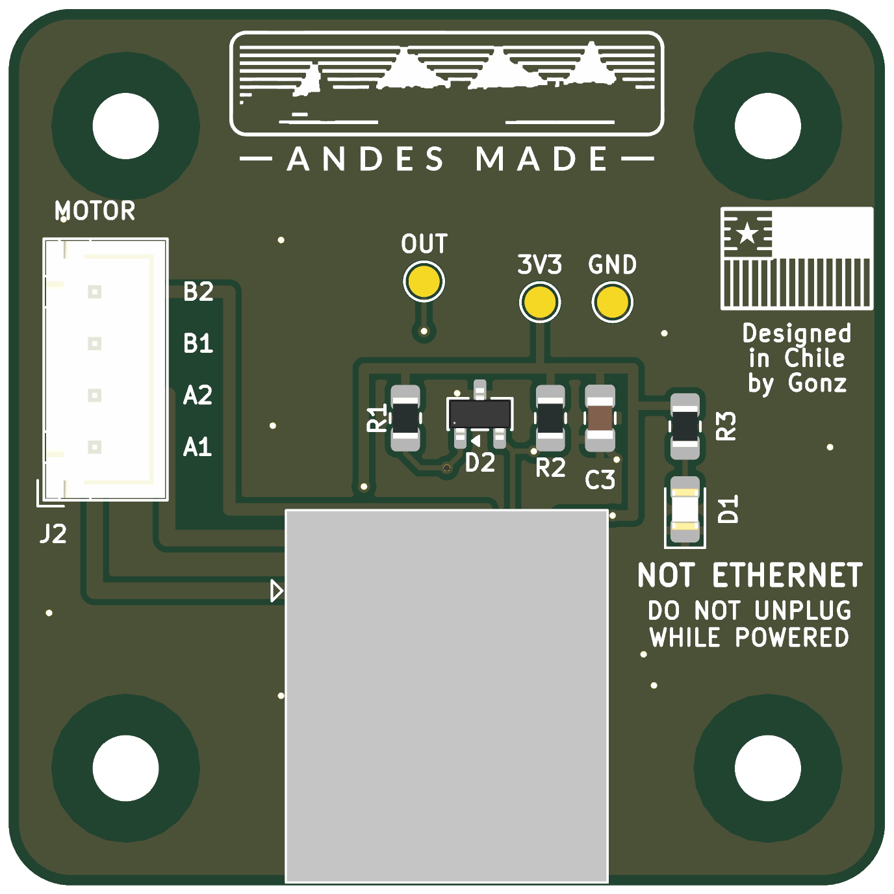
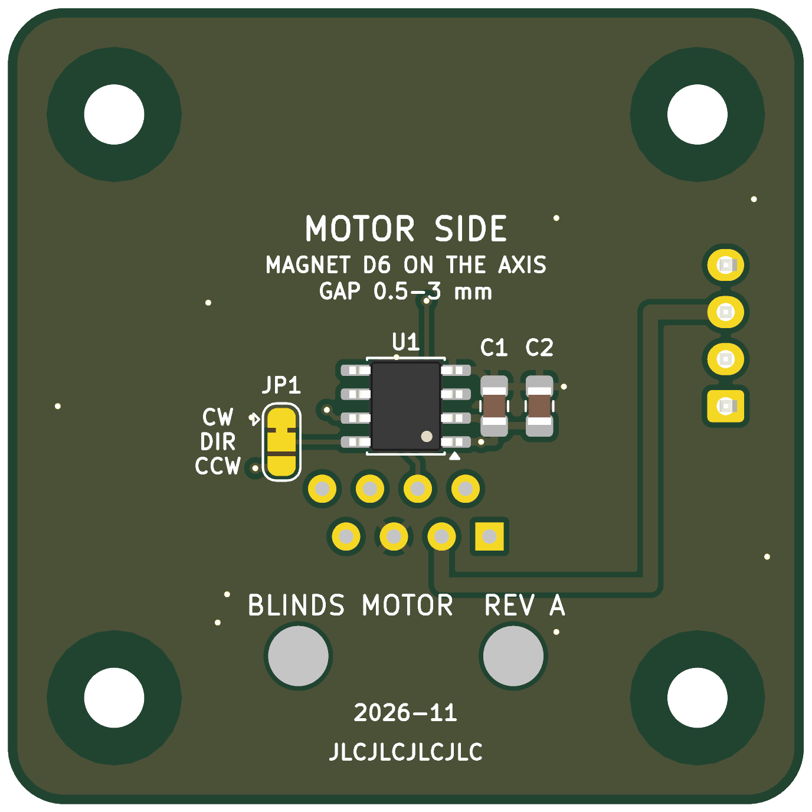

# Smart Blinds — motor encoder board

KiCad 10 project for the small board that sits on the back of the NEMA 17
stepper. It carries the AS5600 magnetic encoder on the shaft axis and the
RJ45 that links the motor to the control panel
([`../blinds-pcb`](../blinds-pcb/README.md)).

**Status: rev A, first layout** (2026-11-17). Schematic ERC clean
([`doc/schematic.pdf`](doc/schematic.pdf)); PCB placed, routed, DRC clean
(0 violations, 0 unconnected, schematic parity clean); fabrication files in
[`fab/`](fab/).

| Outer face | Motor side |
|---|---|
|  |  |

(The motor-side render is seen from below, so it is mirrored.)

## What is on the board

| Ref | Part | Side | Why |
|---|---|---|---|
| U1 | AS5600-ASOM, SOIC-8 | motor | 12-bit angle of the magnet on the shaft, I2C address 0x36 |
| C1, C2 | 100 nF + 1 µF | motor | AS5600 supply (3.3 V operation: VDD5V and VDD3V3 tied together, as in the datasheet) |
| JP1 | 3-pad solder jumper | motor | AS5600 DIR pin. Default bridged to GND (CW); cut and bridge 2–3 for CCW |
| J1 | RJ45 Amphenol 54602-908LF, no magnetics | outer | Cable to the panel. Same jack and pinout as panel J2 |
| J2 | JST-XH 4-pin, vertical | outer | Motor cable: 1 A1, 2 A2 (coil A), 3 B1, 4 B2 (coil B) |
| R1, R2 | 4.7k | outer | I2C pull-ups at the far end; with the panel's 10k ≈ 3.2k total |
| D2 | PESD3V3L2BT | outer | ESD clamp on SDA / SCL where the cable enters |
| C3 | 10 µF | outer | 3V3 bulk at the cable entry |
| R3, D1 | 1k + green LED | outer | Lights when the cable brings 3V3 (≈1 mA) |
| TP1–TP3 | test pads | outer | 3V3, GND, AS5600 OUT (analog angle). SDA / SCL: probe R1 / R2 |
| H1–H4 | M3, non-plated | — | 31 mm NEMA 17 hole pattern |

RJ45 pinout (straight T568B cable, identical to the panel):

| Pin | 1 | 2 | 3 | 4 | 5 | 6 | 7 | 8 |
|---|---|---|---|---|---|---|---|---|
| Signal | Coil A1 | Coil A2 | Coil B1 | SDA | GND | Coil B2 | SCL | 3V3 |

**Not Ethernet.** Never plug it into a network device, and never unplug it
while the panel is powered (motor coils).

## Mechanics

- Board 42.3 × 42.3 mm (the motor body), corners r 3, 1.6 mm FR-4.
- Mounted with four long M3 screws through the motor's own holes (31 mm
  pattern) and spacers. Copper is kept 3.6 mm from each hole for washers
  and spacers; the holes are not plated and not connected to GND (the motor
  case stays floating).
- U1 is exactly on the board centre = shaft axis, on the side facing the
  motor. Needs a **dual-shaft motor** (or a magnet holder on the rear shaft).
- Magnet: diametrically magnetised, Ø6 × 2.5 mm (Ø8 × 3 also works), glued
  centred on the shaft end. Air gap magnet face → chip top **0.5–3 mm**
  (chip is 1.5 mm tall). Choose the spacer length for this.
- Only U1, C1, C2, JP1 are on the motor side. **Trim the RJ45 and XH leads
  flush** after soldering (they come through on the motor side).
- Coil tracks are 0.8 mm (0.6 mm for B2), routed as pairs along the left and
  bottom edges, at least 7 mm from U1. At 1 A they make well under 1 mT at
  the chip, against the magnet's 30–90 mT, and the AS5600 rejects uniform
  stray fields.

## Firmware notes

- Same bus as before: AS5600 at 0x36 on GPIO21/22; keep `I2C_FREQ_HZ 100000`
  (see `../blinds-pcb/doc/pinmap.md`).
- JP1 default (DIR = GND): the angle rises clockwise **seen from the chip
  top**, i.e. from the motor towards the board. If the closed loop counts the
  wrong way, flip it in firmware or re-bridge JP1 — do not swap coil wires.
- AS5600 OUT on TP3 gives an analog angle (0–3.3 V) for a quick magnet check
  with a multimeter while turning the shaft by hand.

## Ordering

`fab/motor-pcb-gerbers.zip` (gerbers + drills), `fab/motor-pcb-pos.csv`,
`fab/lcsc-order.csv`. 2 layers, 1.6 mm, any colour; JLCPCB minimums are met
(0.25 mm tracks, 0.3 mm vias, 0.15 mm silk lines, 0.8 mm text).

**AS5600 stock:** LCSC C79815 showed only 7 pieces on 2026-11-17; buy it at
Mouser / Digi-Key if needed. Do **not** substitute the AS5600L: same package,
but I2C address 0x40 (the firmware expects 0x36).

## Files and scripts

| File | Contents |
|---|---|
| `tools/gen_schematic.py` | Writes `motor-pcb.kicad_sch` and checks the netlist (uses `../blinds-pcb/tools/gen_schematic/sch.py`) |
| `tools/build_pcb.py` | Rebuilds the whole board from the schematic: footprints, outline, holes, placement, routing, GND zones |
| `tools/silk.py` | Silkscreen: references, labels, flag, emblem |
| `tools/artwork.py` | Flag drawing and emblem helpers, shared by `silk.py` and `export_svg.py` (no KiCad needed) |
| `tools/export_svg.py` | Writes the logos as SVG to [`../artwork/`](../artwork/README.md) (with and without text / hatching) |
| `tools/emblem_small.py` | Small "ANDES MADE" volcano emblem (reuses the panel's `emblem.py`), writes `tools/emblem_small.json` |
| `lib/motor.kicad_sym` | AS5600 symbol (KiCad has none) |

Script order, KiCad closed: `gen_schematic.py` → `build_pcb.py` → `silk.py`,
then DRC. **Every script overwrites its output**, including edits made by hand
in KiCad; once the board is edited by hand, stop re-running them.
